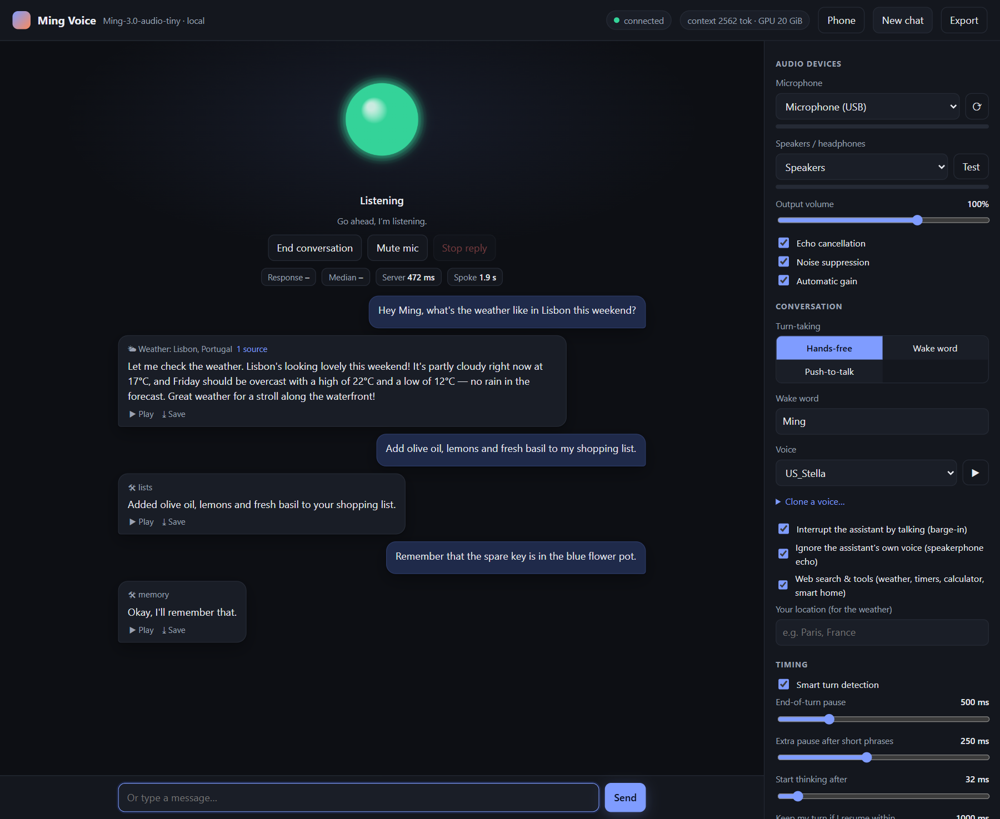
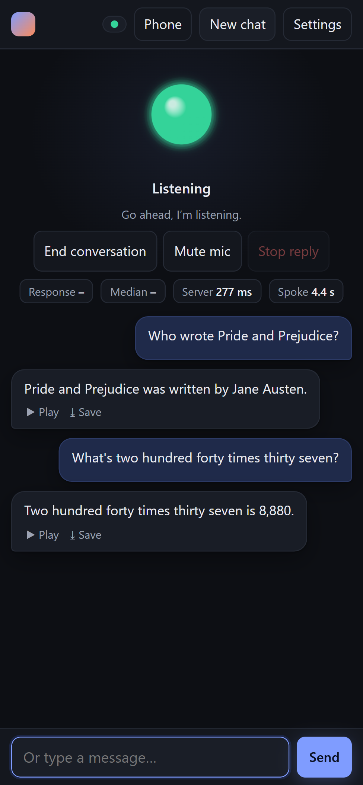
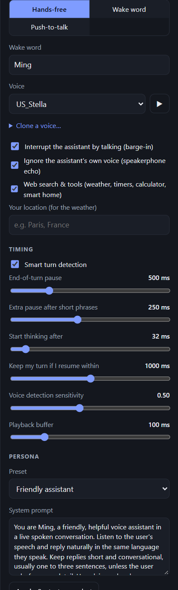

<div align="center">

# Ming Voice

**A fully local, real-time voice assistant for AMD Radeon GPUs (NVIDIA experimental), on Linux or Windows.**<br>
Talk to it and it answers out loud, usually starting **about a quarter of a second** after you stop talking.

[](https://github.com/JMS1717/ming-voice/releases)
[](LICENSE)

[](https://www.paypal.com/paypalme/jasonselsley)



</div>

Ming Voice turns [inclusionAI/Ming-3.0-audio-tiny](https://huggingface.co/inclusionAI/Ming-3.0-audio-tiny), a
speech-to-speech model, into an assistant you can leave running at home. It hears you, decides when you've
finished, thinks, and speaks back, all on your own GPU. It checks the weather, searches the web, sets timers,
keeps your shopping list, remembers what you tell it, and controls Home Assistant and Jellyfin.

**No audio leaves your machine.** With tools on, only search terms and place names go out (to DuckDuckGo or
Brave Search, and Open-Meteo); turn tools off in Settings to stay fully offline.

## See it in action

<div align="center">

<a href="https://www.youtube.com/shorts/JiUd3QXpypo"></a>

<p><a href="https://www.youtube.com/shorts/JiUd3QXpypo"><strong>▶ Watch the Ming Voice demo</strong></a><br>

</div>

## Highlights

**Conversation that feels natural**
- **~0.23 s** from the end of your sentence to the first sound of the answer
- **Smart turn detection** ([Smart Turn v3](https://huggingface.co/pipecat-ai/smart-turn-v3)) hears from your words and intonation whether you've finished, so it answers sooner when you're done and waits when you're mid-thought
- **Interrupt it any time**, even on a speakerphone: it recognises its own voice coming back through the mic and only stops for yours
- **Pause and carry on**: if it starts answering and you keep talking within a second, the answer is withdrawn and everything you said is answered as one turn
- **Hands-free, push-to-talk, or wake word** ("Hey Ming, …"), with a follow-up window so you don't repeat the name
- **Survives restarts**: the conversation is saved after every turn and picked up again

**Useful out of the box**
- Web search, weather, calculator and clock
- **Timers and reminders** that ring again until you answer
- **Shopping and to-do lists**, and **remembering things you tell it** ("I parked on level 3")
- **Home Assistant**: lights and plugs (on/off, brightness, "dimmer", colours, warm white), music and TVs (pause, skip,
  volume, "what's playing?"), thermostat, locks, the car (climate, temperature, defrost), the vacuum, scripts and scenes
  by name. Follow-ups work ("now turn it off", "and the living room too"), and the user's own words are used, not the
  model's rewording. Clear commands skip straight to Home Assistant. **Two at once** ("turn off the desk lamp and lock
  the car"), **for later** ("turn off the lights in 20 minutes", "start the vacuum at 9 am"), and **rooms**: pick the
  room the device is in, and "turn off the lights" means that room's. "Play some jazz on the kitchen speaker" works
  with [Music Assistant](https://music-assistant.io/) installed. **Heads-ups**: a lock or garage door left open at
  night, the vacuum stuck or finished. Also **Jellyfin**, and hand-off to a **Hermes Agent** for bigger jobs
- Risky actions (unlocking, opening the garage) are **confirmed first**
- **Jarvis mode**: a dry-witted British robot butler ("Certainly, sir.") with its own designed voice and wake word
- Say **"that's all, bye"** and it ends the conversation (in wake-word mode it goes back to sleep)

**Made to be lived with**
- Runs **always on** with the PC's own mic and speakers, no browser tab needed
- **Use it from your phone** over HTTPS on your home network (QR code, installable web app)
- **Inside Home Assistant's Assist** (Wyoming protocol): Ming as speech-to-text, text-to-speech and conversation
  agent for a Voice PE, other voice satellites, or the Assist button in the HA app
- 7 built-in voices plus **voice cloning** from a 5–15 s sample
- Speaks numbers, money and units properly ("$1,299.99", "−5°C", "24-17", "12 km/h")
- **OpenAI-compatible API** for text-to-speech, transcription, and chat with audio in and out
- English and Chinese

<div align="center">
<table>
<tr>
<td align="center" valign="top"></td>
<td align="center" valign="top"></td>
</tr>
<tr>
<td width="300" valign="top"><b>On your phone</b>: the same app over your home Wi-Fi, installable on the home screen.</td>
<td width="197" valign="top"><b>Tune everything</b>: turn-taking, voice, timing and persona.</td>
</tr>
</table>
</div>

## Performance

Measured on a Radeon RX 7900 XTX (24 GB):

| | |
|---|---|
| End of your speech → first audio | **~0.23 s** median. The reply is generated during the end-of-turn pause (0.2 s when Smart Turn is confident) and is ready when the pause ends |
| Thinker (audio LLM, 9.3B MoE / 2.7B active) | ~115 tokens/s; first token ~80 ms after a short spoken turn |
| Talker (speech synthesis) | ~0.3× real time; 13 ms per 80 ms of audio for the core step |
| Startup | ~30 s (first start after install: 1–2 min to compile kernels) |
| VRAM | ~20.5 GB in bf16, ~12.5 GB with int8 experts (automatic on cards under 23 GB) |
| Speech quality | 1.0% word error rate when its speech is transcribed back (same as the reference implementation) |

## Quick start

### Requirements

- **Linux** (x86_64): Arch, CachyOS, EndeavourOS, Manjaro, Ubuntu, Debian, Pop!_OS, Mint, Fedora, Nobara or
  openSUSE (others work too if they have git and curl), **or Windows 11** with WSL2 (the installer sets it up)
- A GPU with **16 GB+ VRAM**:
  - **AMD** Radeon RX 6800 or newer: RX 7000 / 9000 series and Radeon PRO cards (tested on the RX 7900 XTX).
    On Linux it only needs the standard `amdgpu` driver that comes with your kernel: PyTorch brings its own ROCm 7.2,
    so there's no ROCm to install. On Windows: a recent Adrenalin driver with WSL support.
  - **NVIDIA** RTX 30 series or newer (e.g. RTX 3090, 4060 Ti 16 GB, 4080, 4090, 5080, 5090), with a current
    driver (on Linux: your distro's NVIDIA driver, e.g. `nvidia-open` on Arch/CachyOS). *Experimental:* the
    installer sets it up with CUDA PyTorch and the code is vendor-neutral, but it hasn't been tested on a 16 GB
    NVIDIA card yet. Reports welcome!
- ~30 GB free disk (20 GB model + Python environment)

### Install

**Linux:** open a terminal and paste:

```bash
curl -fsSL https://raw.githubusercontent.com/JMS1717/ming-voice/main/install.sh | bash
```

It installs what's missing (git, curl, openssl, PortAudio) with your package manager, finds your GPU, sets up
Python and PyTorch for it (ROCm 7.2 or CUDA 12.8, nothing system-wide), downloads the model (~20 GB) into
`~/ming-voice`, and adds **Ming Voice** to your app menu. It may ask for your password (for the packages, and on
AMD to add you to the `render` group that may use the GPU; log out and back in once after that). If anything
stops halfway, run it again: finished steps are skipped. Set `MING_DIR` to install somewhere else.

**Windows:** open **PowerShell** and paste:

```powershell
irm https://raw.githubusercontent.com/JMS1717/ming-voice/main/install.ps1 | iex
```

That's it. It sets up WSL and Ubuntu 24.04 if you don't have them yet, then installs ROCm (AMD only), the Python
environment and the model (~20 GB download), and puts a **Ming Voice** shortcut on your Desktop. On AMD it asks for
your Linux password once (for ROCm). If anything stops halfway, run it again: finished steps are skipped.
(Prefer not to paste commands? Download the repo and double-click `Install.cmd`.)

Already in a WSL Ubuntu shell? Same thing from there:

```bash
git clone https://github.com/JMS1717/ming-voice.git ~/ming-voice
bash ~/ming-voice/install.sh
```

<details>
<summary>What the installer runs (manual install)</summary>

```bash
sudo bash scripts/install_rocm_wsl.sh      # AMD only: ROCm 7.2.4 + librocdxg (WSL GPU bridge); then wsl --shutdown
bash setup_env.sh                          # Python env (ROCm or CUDA PyTorch, needs uv) + model download (~20 GB)
```

</details>

### Run

- **Windows:** double-click **Ming Voice** on your Desktop (or `windows\Ming Voice.cmd` in the repo, at
  `\\wsl.localhost\Ubuntu-24.04\home\<you>\ming-voice`). It starts the server, waits for the model, and opens
  <http://localhost:8000>.
- **WSL shell:** `./run.sh`, then open <http://localhost:8000>.
- **Linux:** **Ming Voice** in your app menu, or `ming-voice` in a terminal. It starts the server in the
  background, waits for the model, and opens <http://localhost:8000>. `ming-voice --stop` stops it (it holds
  ~20 GB of VRAM), `ming-voice --status` and `ming-voice --logs` show what it's doing, `ming-voice --help` lists
  the rest. (Or run `./run.sh` in the folder, in the foreground.)

Press **Start conversation**, allow the microphone, and talk. Pause when you're done.

> Windows: keep the server window open while you use it: WSL shuts its VM down when nothing is attached. Close it
> when you're done, since it holds ~20 GB of VRAM.

## Using it

- **Interrupt** by talking over it. If it still interrupts itself in a very echoey room, turn **barge-in** off in Settings.
- **Shortcuts:** <kbd>Space</kbd> hold to talk (push-to-talk mode), <kbd>M</kbd> mute, <kbd>Esc</kbd> stop the reply, <kbd>N</kbd> new conversation.
- **Wake word** (Settings → Turn-taking) is for a PC, tablet or old phone that listens all the time. It only
  answers speech that starts with its name: "Hey Ming, turn off the lamp", or "Hey Ming" on its own and wait for
  the chime. For 8 s after each reply you can follow up without the name. Any name works; "Ming" is recognised best.
- **Clone a voice** in the sidebar: record or upload 5–15 s of one person speaking. Voices are saved in `voices/`.
- **Type** instead of talking in the box at the bottom; the answer is still spoken.
- **Jarvis mode**: pick **Jarvis (robot butler)** under Settings → Persona. It switches to the Jarvis voice and the
  wake word "Jarvis" (your own come back when you pick another preset), and even the tool confirmations are in
  character ("Very good, sir. I've turned off the lamp."). The voice is an original one made with the Talker's voice
  design (`dev/design_voice.py`), not a copy of anyone's.
- **End the conversation** by saying goodbye ("that's all, thanks", "goodnight", "end the conversation"): it says
  goodbye and stops listening, or goes back to sleep in wake-word mode.

### Always on, without a browser

`windows\Ming Voice (always on).cmd` starts the server (minimized), phone access, and `windows\ming_client.py`,
a background client that uses the PC's own microphone and speakers. Just say "Hey Ming, …" any time. Timer alarms
and announcements play through the speakers too.

**On Linux:** `ming-voice --always-on` (or *Always on* in the app menu entry's right-click menu) does the same, with
the same client and settings. `ming-voice --autostart --always-on` starts it when you log in (add `--phone` for
phone access too; `--no-autostart` undoes it), and `ming-voice --stop` stops it. The notes below apply to both,
with the paths on Linux being `.venv/bin/python windows/ming_client.py` and `ming_client.log`.

- **Start at sign-in:** run `powershell -ExecutionPolicy Bypass -File windows\install_autostart.ps1` once
  (`-Remove` undoes it; `-Browser` autostarts the browser app instead).
- **Needs** Python for Windows with `pip install sounddevice websockets numpy`.
- **Settings** go in `.client.json` in the project folder (not committed), for example
  `{"wake_word": "Ming", "home": "Paris", "voice": "US_Emma", "input_device": "USB Mic", "barge_in": false}`.
- **Pick the right microphone:** `python windows\ming_client.py --test-mics` shows each microphone's level while
  you talk (`--list-devices` lists them all). The log, `windows\ming_client.log`, names the mic in use and warns
  when it has heard nothing for 10 minutes. `--stop` stops the client.
- **On speakers** the mic is muted while Ming talks, so it never answers itself. With a headset, set
  `"barge_in": true` to talk over it.
- **One device at a time:** opening the app on your phone takes over, and the PC client takes it back 15 s after
  the phone app is closed.
- The server **restarts by itself** after a crash or an unrecoverable GPU error (`run.sh` with `MING_SUPERVISE=1`,
  which the launcher sets).

### On your phone

Start with `windows\Ming Voice (phone).cmd` (or run `python windows\lan_proxy.py` on Windows next to a running
server), press **Phone** in the app on the PC, and scan the QR code. The phone opens
`https://<pc-ip>:8443/?key=…`; the key is swapped for a cookie, so the link only has to be opened once.

- Phones only allow the microphone over HTTPS, so the proxy uses a **self-signed certificate** (created on first
  run in `certs/`). The phone warns once that the connection isn't private: tap *Advanced → Proceed*
  (Safari: *Show Details → visit this website*).
- Everything arriving from the network needs the access key (`.lan_key`, created on first start). Delete the
  file and restart to change it.
- WSL2 isn't reachable from the network by itself, which is why the proxy runs on Windows (standard library
  only). If Windows Firewall asks, allow Python on private networks.
- **Linux:** `ming-voice --phone` starts the same proxy next to the server. With a firewall on (Fedora and
  openSUSE have one by default), allow port 8443/tcp: `sudo firewall-cmd --add-port=8443/tcp --permanent && sudo
  firewall-cmd --reload` (ufw: `sudo ufw allow 8443/tcp`).
- Add the page to your home screen to use it like an app; the screen stays on during a conversation.

## Tools

With **Web search & tools** on (Settings, default), the model decides when to call a tool; Ming-3.0's LLM was
trained for function calling. It says "Let me look that up" while a slow one runs, and the reply shows what it
used and its sources.

| Tool | Try saying | Needs |
|---|---|---|
| `web_search` | "Who won the game last night?", "research the best electric cars this year". DuckDuckGo, or Brave Search (fresher) with a key | optional `.brave_key` or `MING_BRAVE_KEY` ([Brave Search API](https://brave.com/search/api/), free tier) |
| `get_weather` | "What's the weather like this weekend?" Current weather and a 3-day forecast from Open-Meteo; "Your location" in Settings is the default | – |
| `calculate`, `get_current_time` | Exact arithmetic; the time in other time zones (the local date and time come with every turn, so "what time is it?" needs no tool) | – |
| `timer` | "Set a timer for 10 minutes", "remind me to call mom at 5 pm", "how long is left?", "cancel the pasta timer". When one goes off it chimes and says so, again every minute (twice more) until you answer. Kept in `.timers.json`, so they survive a restart | – |
| `lists` | "Add milk and eggs to my shopping list", "what's on my to-do list?", "I bought the eggs", "clear my shopping list". Shopping, to-do, or any list you name, kept in `.lists.json` | – |
| `memory` | "Remember that I parked on level 3", "forget where I parked". Up to 40 facts in `.memory.json`, given to the model in every conversation, so "where did I park?" works days later | – |
| `home_assistant` | "Turn off the kitchen lights", "is the car locked?" "Which lights are on?", "turn off the living room lights". Ming reads HA's device, area and entity registries itself, so it sees **every** light, plug, lock, thermostat, fan, vacuum and speaker the token can (lamps on smart plugs count as lights; config and hidden entities are skipped), and the model is told your device names by room. Anything else goes to HA's own Assist. `MING_HA_DIRECT=0`: Assist only, so **only entities exposed to voice assistants** can be touched | `.ha_token` (HA → your profile → Security → long-lived token), `.ha_url` or `MING_HA_URL` (default `http://homeassistant.local:8123`) |
| `jellyfin` | "Play The Office on the TV", "pause", "what's playing?", "do I have Dune?" Searches your library and controls open Jellyfin players; a series continues from the next unwatched episode | `.jellyfin.json`: `{"url": "http://<host>:8096", "key": "<API key>"}` |
| `ask_hermes` | "Ask Hermes to …" hands a bigger job to a [Hermes Agent](https://github.com/NousResearch/hermes-agent) in the background; the answer is announced when it's ready. Only when you say "Hermes" (`MING_HERMES_AUTO=1` lets Ming hand it anything its own tools can't do) | `.hermes.json`: `{"url": "http://<host>:8642", "key": "<API_SERVER_KEY>"}` |

**Guard rails that keep it honest and safe:**
- Tools that change something (timers, lists, memory, Home Assistant, Jellyfin, Hermes) never run for a
  speculative reply. They wait until your turn has really ended, so a pause mid-sentence can't switch a light.
- **Risky actions are confirmed first.** Unlocking, opening a garage door or gate, and disarming an alarm get a
  question back (*"Just to be sure: do you want me to unlock the front door?"*) and only happen when you say yes
  in your next turn, within a minute. `MING_CONFIRM_RISKY=0` turns this off.
- Jellyfin only starts playback when you said to (play, watch, put on, listen, …).
- Answers you can listen to: one from search results ends after a few sentences, and any other after about 30 s
  of speech, unless you asked for something long (a story, a recipe, steps, "in detail", …).
- If a reply starts by claiming it can't look things up ("I don't have access to real-time data…"), it's caught
  before it's spoken and becomes a web search or weather lookup instead. And if a reply says it changed a list or
  forgot something without calling the tool, that call is made for it, so what it said is true.

### Announcements from Home Assistant (or anything else)

Ming can tell you what happens at home: the doorbell, the washer finishing, the garage left open. With a Home
Assistant token configured, the server listens for **`ming_announce`** events, so all it takes is an automation
with an *event* action (no integration, no `configuration.yaml` change, no restart):

```yaml
alias: Doorbell → Ming
triggers:
  - trigger: state
    entity_id: binary_sensor.front_doorbell
    to: "on"
actions:
  - action: event
    event: ming_announce
    event_data:
      message: Someone is at the front door.
      # chime: false      no chime before it
      # verbatim: false   pass it on in Ming's own words instead of exactly
      # ttl: 300          drop it if it can't be said within this many seconds
```

Or from a script or another server, `POST /api/announce` with the same fields as JSON (on the LAN port, with
`Authorization: Bearer <access key>`):

```bash
curl -X POST http://localhost:8000/api/announce -H "Content-Type: application/json" \
  -d '{"message": "The washer is done."}'
```

An announcement waits for a quiet moment, plays a short chime, and is said whether the wake word was heard or
not. `MING_HA_EVENTS=0` turns the event listener off.

### In Home Assistant's voice assistants (Voice PE, satellites)

Ming can also take part in Home Assistant's own **Assist** pipelines, so a Home Assistant Voice PE, an ESPHome or
Wyoming satellite, or the Assist button in the HA app talks to Ming. `wyoming_bridge.py` speaks HA's Wyoming
protocol on port 10300 and offers three services; use any mix of them (for example, keep your speech-to-text and
use Ming for the rest):

| Service | |
|---|---|
| Speech-to-text | Ming's own speech recognition (English and Chinese) |
| Text-to-speech | Ming's voices, cloned ones included. When an LLM's reply streams in, it's spoken a sentence at a time |
| Conversation agent | Ming's model with its tools: web search, weather, timers, lists, memory and Home Assistant. Each conversation keeps its context, and on a satellite "turn off the lights" means the lights in that satellite's area. "What's the weather?" is for Home Assistant's home location |

1. Start the bridge with the server:
   - **Windows:** `windows\Ming Voice (Home Assistant).cmd` (or `-Wyoming` for `start_ming_voice.ps1`). It runs on
     Windows' Python, like phone access, since WSL2 can't be reached from the network. If Windows Firewall asks,
     allow Python on private networks.
   - **Linux:** `ming-voice --wyoming` (`ming-voice --autostart --wyoming` to start it at login). With a firewall,
     allow port 10300/tcp.
2. In Home Assistant: **Settings → Devices & services → Add integration → Wyoming Protocol**, with this PC's
   address and port `10300`.
3. **Settings → Voice assistants → Add assistant**: choose Ming as the conversation agent, speech-to-text and/or
   text-to-speech, then pick that assistant on your Voice PE's device page.

Good to know:
- To control devices, Ming as the conversation agent uses its own Home Assistant access (`.ha_token`, see
  [Tools](#tools)). Without a token, turn on **Prefer handling commands locally** in the assistant so Home
  Assistant handles device commands and Ming the rest.
- This route takes turns the way Assist does: the satellite records until you stop, then Ming transcribes,
  answers and speaks. That's slower than Ming's own app and always-on client, which start answering during your
  end-of-turn pause (the ~0.23 s), and it has no interrupting. Requests from several satellites take turns on the GPU.
- The Wyoming protocol has no authentication, so the bridge only accepts connections from private-network
  addresses. `--allow <Home Assistant's address>` (or `MING_WYOMING_ALLOW`) restricts it to Home Assistant.
  Other options: `--port`, `--voice` (the default voice), `--services stt,tts,conversation`.

## OpenAI-compatible API

The same server speaks the OpenAI API; interactive docs are at <http://localhost:8000/docs>.

| Endpoint | |
|---|---|
| `POST /v1/audio/speech` | Text to speech: `{"input": "...", "voice": "US_Emma", "response_format": "wav"}` (wav, mp3, flac, pcm). wav and pcm stream as they're generated, first audio after ~0.12 s. OpenAI voice names (alloy, nova, …) map to built-in voices; cloned voices work by name |
| `POST /v1/audio/transcriptions` | Speech to text (multipart `file`), any length, English or Chinese |
| `POST /v1/chat/completions` | Chat with text and/or audio input (`input_audio` parts) and optional spoken output (`"modalities": ["text", "audio"]`); `stream: true` streams text and pcm16 audio. Greedy decoding. OpenAI function calling isn't supported, but `"ming": {"tools": true}` lets the reply use Ming's own tools (and `"room": "Kitchen"` sets the Home Assistant area) |
| `GET /v1/models` | `ming-3.0-audio-tiny` |

```bash
curl http://localhost:8000/v1/audio/speech -H "Content-Type: application/json" \
  -d '{"input": "Hello from Ming Voice!", "voice": "US_Emma"}' -o hello.wav
curl http://localhost:8000/v1/audio/transcriptions -F file=@hello.wav
```

```python
from openai import OpenAI
client = OpenAI(base_url="http://localhost:8000/v1", api_key="unused-on-localhost")
print(client.chat.completions.create(model="ming-3.0-audio-tiny",
      messages=[{"role": "user", "content": "Tell me a fun fact about otters."}]).choices[0].message.content)
```

From another device, use `https://<pc-ip>:8443/v1` with `api_key=<contents of .lan_key>` and accept the
self-signed certificate (`curl -k`, or pass `certs/lan.crt` as the CA). API requests share the GPU with the
voice session; chat requests run on an isolated copy of the conversation state, so they never disturb a live
conversation.

## Settings and configuration

<details>
<summary><b>Timing settings</b> (in the app)</summary>

| Setting | Default | Meaning |
|---|---|---|
| Smart turn detection | on | Ends the turn after a 200 ms pause when you've clearly finished, waits up to 1.5 s when you sound mid-sentence, and uses the end-of-turn pause otherwise |
| End-of-turn pause | 500 ms | Silence that ends your turn (when Smart Turn is off or unsure). Lower is snappier but more likely to cut you off |
| Extra pause after short phrases | 250 ms | Added when you've said less than 1 s ("Can you tell me…"), which is usually unfinished |
| Start thinking after | 32 ms | When speculative generation starts (discarded if you keep talking) |
| Keep my turn if I resume within | 1000 ms | Carry on this soon after it starts answering and the answer is withdrawn; everything you said is answered as one turn (0: carrying on interrupts it) |
| Ignore the assistant's own voice | on | Echo-aware barge-in for speakers |
| Voice detection sensitivity | 0.50 | Silero VAD threshold |
| Playback buffer | 100 ms | Client jitter buffer |

</details>

<details>
<summary><b>Environment variables</b> (for <code>run.sh</code>)</summary>

| Variable | Default | |
|---|---|---|
| `HOST` / `PORT` | `127.0.0.1` / `8000` | Bind address. Local-only by default; use the phone proxy for other devices. `HOST=0.0.0.0` exposes port 8000 directly, without HTTPS (no microphone in browsers) and without a key unless `MING_API_KEY` is set |
| `MING_LAN_PORT` | `8001` | Key-protected port for the phone proxy (localhost only; `lan_proxy.py --target`) |
| `MING_API_KEY` | – | Require this key (`Authorization: Bearer …`) on every port, including localhost |
| `MING_WYOMING_PORT` / `MING_WYOMING_ALLOW` | `10300` / private networks | The Home Assistant bridge's port, and who may connect (comma-separated addresses or networks) |
| `MING_MODEL_DIR` | `./model` | Model folder |
| `MING_MAX_CTX` | `8192` (`16384` from 32 GB of VRAM, `4096` in int8 mode) | Conversation context in tokens. Costs VRAM (~60 MB per 1k tokens, plus larger graph buffers) but not speed: attention only reads the filled part. When it fills up, the context is rebuilt between turns (~0.5 s) from the conversation so far as text |
| `MING_INT8_EXPERTS` | `auto` | Weight-only int8 for the MoE experts (`1`, `0`, or `auto` = int8 below 23 GB VRAM, or when the full model doesn't fit next to other programs). Identical greedy replies and transcripts on the test set, logit cosine ≥ 0.997 |
| `MING_VRAM_LIMIT_GB` | – | Cap PyTorch's VRAM use (to emulate a smaller card) |
| `MING_CFM_STEPS` | `10` | Talker flow-matching steps (fewer is faster but degrades speech) |
| `MING_SMART_TURN` | `1` | Smart Turn end-of-turn detection |
| `MING_FUSED_PREFILL` / `MING_PREFILL_GRAPHS` / `MING_FUSED_OPS` | `1` | Fused Triton prefill MoE, graph-captured prefill, Triton RMSNorm and router (`0` = reference code) |
| `MING_FAST_TALKER` / `MING_GRAPHS` | `1` / `1` | Fused Triton Talker path / HIP graphs (`0` = reference code) |
| `MING_ECHO_DEBUG` | unset | Log what the echo guard measured whenever a barge-in fires |
| `MING_TRACEMALLOC` | `0` | Python allocation tracing for `/api/debug/mem` |
| `MING_CONFIRM_RISKY` | `1` | Ask before unlocking, opening the garage or gate, or disarming an alarm |
| `MING_HA_DIRECT` | `1` | Home Assistant: control every device the token can see (`0` = only through Assist, i.e. entities exposed to voice assistants) |
| `MING_HA_EVENTS` | `1` | Say Home Assistant `ming_announce` events (needs `.ha_token`) |
| `MING_HA_ALERTS` | `1` | Heads-ups: a lock or garage/door left open at night for 10 minutes, the vacuum stuck or finished |
| `MING_ALERT_NIGHT` | `22-6` | The hours (start-end) when an unlocked lock or open door is worth a heads-up |
| `MING_HERMES_AUTO` | `0` | `1`: hand Hermes anything Ming's own tools can't do, not only what you ask Hermes for by name |
| `MING_SUPERVISE` | `0` | `1`: restart the server when it crashes (the Windows launcher sets it) |
| `MING_ALARM_REPEATS` / `MING_ALARM_REPEAT_S` | `2` / `60` | How many more times a timer that went off is repeated, and how many seconds apart |
| `MING_RESUME_S` | `1800` | After a restart, continue a conversation saved less than this many seconds ago (`0`: always start afresh) |

</details>

## How it works

```
browser (static/index.html) ⇄ WebSocket: 16 kHz PCM in / 44.1 kHz PCM out ⇄ server.py
  server.py   Silero VAD · Smart Turn (turn_detect.py) · speculative turn-taking with rollback · barge-in
              · resume (a reply you talk over within resume_ms is undone and your turn continues)
              · echo guard (echo_guard.py: mic vs. played-audio correlation, so its own voice can't barge in)
              · push-to-talk · voice cloning · background transcription
  api.py      OpenAI-compatible /v1 API (speech, transcriptions, chat with audio in/out)
  tools.py    web search, weather, timers, lists, memory, Home Assistant, Jellyfin, Hermes
  ha.py       Home Assistant device list (registries over the websocket API), command parsing and control
  lan.py      access key + cookie login for the LAN port; windows/lan_proxy.py terminates HTTPS on Windows
  wyoming_bridge.py  Home Assistant's Wyoming protocol (speech-to-text, text-to-speech, conversation) -> /v1 API
  engine.py   Thinker: Ming audio LLM (hybrid Kimi-delta-attention / MLA, 128-expert MoE)
                - static-state cache, one HIP graph per attention-length bucket (8.7 ms/token)
                - prefill graphs too: prompts padded to 32/64/128 tokens, padding made a no-op for the
                  recurrent KDA layers (zero write strength, unit decay, conv state rebuilt from real tokens)
                - fused Triton MoE with the shared expert folded in (fused_moe.py): a GEMV kernel pair
                  for decode, grouped tl.dot kernels for prefill (tokens sorted by expert on the GPU)
                - multi-turn KV reuse, snapshot/restore for speculation, text-history rollover
              Talker: Qwen2 + 10-step flow-matching DiT + AudioVAE
                - fused Triton fast path (fast_talker.py, fastlinear.py): RMSNorm/bias/activation/
                  residual fused into small-M GEMMs, tiny rotary+attention kernel, decode attention
                  over a static KV cache, constants hoisted out of the flow-matching loop
                - HIP graph per step, streaming VAE decode
  direct_load.py  builds the model on the GPU and streams weights in with parallel reads
```

The main speedups over the reference implementation came from replacing rocBLAS's slow small-M biased GEMMs
(~45 µs) with fused Triton kernels (~20 µs), cutting kernel launches (the reference MoE prefill launched ~5
kernels per active expert per layer plus a host sync, ~120 ms per turn, now ~15 ms), graph-capturing every
per-token step, and hiding model latency inside the end-of-turn pause.

## FAQ

- **Does it run on a Home Assistant Green, a Raspberry Pi or a NAS?** No: it needs a PC with a 16 GB+ GPU. Home
  Assistant can stay where it is. Ming reaches it over the network (HA's API, with a token), and HA can use Ming
  in its voice assistants through the [Wyoming bridge](#in-home-assistants-voice-assistants-voice-pe-satellites).
- **Is it a Home Assistant add-on?** No, it's a standalone app on the GPU machine: its own speech pipeline (one
  audio model hears, thinks and speaks), its own web app and always-on client. It controls Home Assistant through
  HA's API, says what HA automations send it, and can serve HA's Assist pipelines.
- **Which GPUs work?** AMD RX 6800 or newer and NVIDIA RTX 30 series or newer, with 16 GB of VRAM or more (16 GB
  cards use int8 experts, ~12.5 GB). 12 GB cards don't fit the model with its working memory. GTX 10/16 series,
  RTX 20 series and Tesla P40 cards aren't supported (too little VRAM, or no bfloat16 support for the model's
  GPU kernels).
- **Apple Silicon?** Not supported: the model's code needs Triton GPU kernels (flash-linear-attention), which don't
  run on Apple GPUs. Pull requests are welcome.
- **Other languages?** The model understands and speaks English and Chinese only.
- **Power use?** Between turns the GPU is idle (listening and voice detection run on the CPU), so it draws about
  its normal idle power, with the VRAM full. It only works hard for the second or two of each answer. Stopping the
  server (`ming-voice --stop`, or closing its window on Windows) frees the VRAM for games.
- **Several rooms?** One device holds a live conversation at a time: the web app on a phone or tablet, or the
  always-on client on a PC. For a speaker in every room, use Home Assistant voice satellites with the Wyoming
  bridge; their requests take turns on the GPU.

## Troubleshooting

- **`No HIP GPUs are available`**: in WSL, `HSA_ENABLE_DXG_DETECTION=1` must be set (`run.sh` does it). On Linux,
  your user must be in the `render` group (`groups` shows it; the installer adds you, then log out and back in).
- **Linux, AMD GPU not listed by PyTorch** (e.g. an RX 6700 XT or 7600): the installer writes the closest supported
  GPU to `.gpu_env` (`HSA_OVERRIDE_GFX_VERSION`); edit or delete that file to change it. With an integrated GPU too,
  `.gpu_env` also picks the big one (`ROCR_VISIBLE_DEVICES`).
- **`out of GPU memory while loading`**: other programs hold VRAM (the log says how much). The launchers then
  start again with int8 experts (~12.5 GB), and give up after three failed starts in a row. Games and GPU-accelerated apps free it when closed; on Windows,
  virtual or streaming displays (and high-resolution monitors) driven by the same GPU can also hold several GB.
- **`Python.h: No such file or directory` or `Failed to find C compiler`** at the first reply: Triton compiles a
  small launcher there. `setup_env.sh` uses uv's own Python, which comes with its headers, and rebuilds an older
  `.venv` that lacks them; without gcc or clang it installs Zig's compiler into `.venv`. Run `bash setup_env.sh`
  again (or install `python3-dev` and `gcc`).
- **The first request after idle takes minutes**: under WSL, an AMD GPU that drives no display stops serving WSL
  work promptly when idle. The server runs a tiny keep-alive kernel a few times per second.
- **Slow loading or swapping**: the loader streams weights straight to the GPU; Hugging Face's loader peaks at
  ~15 GB of host RAM, more than WSL allows by default.
- **It cuts you off**: raise the end-of-turn pause in Settings.
- **The always-on client never hears you**: run `python windows\ming_client.py --test-mics` (Linux:
  `.venv/bin/python windows/ming_client.py --test-mics`) and set `input_device` in `.client.json`.
- Logs are in `server.log` (Linux: `ming-voice --logs`); health is at <http://localhost:8000/api/health>.

## Development

<details>
<summary><b>Tests and benchmarks</b> in <code>dev/</code> (run from the repo root against a running server unless noted)</summary>

- `dev/e2e_test.py`: acts like a microphone over the WebSocket: latency, multi-turn memory, hesitation handling, barge-in (`dev/make_questions.py` regenerates its audio)
- `dev/test_routing.py`: spoken everyday questions and which tools each one uses (none for general knowledge)
- `dev/test_tools.py`: every tool, offline parts included (`--hermes` to include Hermes)
- `dev/test_ha_model.py`: the real model against a made-up home: do spoken commands reach the right devices? (stop the server first)
- `dev/test_speech_text.py`: offline: symbols, money, ranges and units rewritten for the voice
- `dev/robustness.py`: long input, Chinese, noise only, double barge-in
- `dev/test_resume.py`: pause mid-question until the reply starts, then continue: one answer to the whole question
- `dev/echo_test.py`: speakerphone simulation; must never interrupt itself but must stop for a real interruption (`dev/test_echo_guard.py`: offline)
- `dev/test_api.py`: every `/v1` endpoint, plus a live conversation that must survive the API calls
- `dev/test_turn.py`: Smart Turn scores on complete vs. truncated questions
- `dev/eval_steps.py`: speech quality (ASR round-trip WER) vs. diffusion steps (standalone, needs the GPU)
- `dev/e2e_compare.sh 32:1 64:1`: e2e under several `spec_ms:smart_turn` settings
- `dev/test_fast_tail.py`, `dev/test_fast_llm.py`, `dev/test_sensitivity.py`: fused paths vs. reference
- `dev/test_moe_prefill.py` (`TUNE=1` to re-tune), `dev/test_prefill.py`, `dev/test_prefill_layer.py`, `dev/test_prefill_graphs.py`: fused and graph-captured prefill vs. reference
- `dev/test_encoder.sh`, `dev/profile_prefill.py`: audio encoder and prefill timing
- `dev/tts_check.py`, `dev/test_clone.py`, `dev/test_takeover.py`: API checks

</details>

## Credits and licenses

- This project: MIT (see [`LICENSE`](LICENSE)).
- Model: [Ming-3.0-audio-tiny](https://huggingface.co/inclusionAI/Ming-3.0-audio-tiny) by inclusionAI (MIT).
  The weights are downloaded from Hugging Face, not included here; the model's own code is loaded from the model
  folder with `trust_remote_code`.
- [Smart Turn v3](https://github.com/pipecat-ai/smart-turn) by Pipecat (BSD-2-Clause), downloaded by `setup_env.sh`.
- [Silero VAD](https://github.com/snakers4/silero-vad) (MIT), [flash-linear-attention](https://github.com/fla-org/flash-linear-attention) (MIT), PyTorch, ROCm and Triton.

## Support

If Ming Voice is useful to you, you can support its development with a
**[donation through PayPal](https://www.paypal.com/paypalme/jasonselsley)**. Thank you!
